  <a href="https://micro-ki.de/about"><strong>Über mich (micro-ki.de/about)</strong></a>
  &nbsp;&nbsp;·&nbsp;&nbsp;
  <a href="https://micro-ki.de"><strong>Micro KI+ Plattform</strong></a>
  &nbsp;&nbsp;·&nbsp;&nbsp;
  <a href="https://micro-ki.de/wie-wir-entwickeln"><strong>Wie wir entwickeln</strong></a>
  &nbsp;&nbsp;·&nbsp;&nbsp;
  <a href="https://micro-ki.de/alternative-zu-claude-code-und-cursor"><strong>OpenCode v2 Benchmark</strong></a>
  &nbsp;&nbsp;·&nbsp;&nbsp;
  <a href="https://www.linkedin.com/in/joerg-thode/"><strong>LinkedIn</strong></a>

---

## Über mich

Ich bin **[Jörg Thode](https://micro-ki.de/about)** aus Mainz — gelernter Fachinformatiker für Anwendungsentwicklung, Scrum.org-zertifizierter Product Owner (**PSPO I**) und Gründer von **[Micro KI+](https://micro-ki.de)** ([`@Micro-KI`](https://github.com/Micro-KI)).

Seit **1999** entwickle ich Webanwendungen, E-Commerce-Plattformen und Schnittstellen zwischen ERP-, PIM-, Shop- und Recruiting-Systemen. Im Enterprise-E-Commerce betreue ich als Fullstack-Entwickler und Interims-Product-Owner Multi-Mandanten-Architekturen (Shopware 6, Symfony-Middleware, CakePHP, REST/SOAP/EDI, n8n).

Unter **[Micro KI+](https://micro-ki.de)** baue und betreibe ich eigene spezialisierte Software-Werkzeuge in Deutschland nach einem klaren Grundsatz: **Ein Problem richtig zu Ende denken, deterministische Prüfungen vor das Sprachmodell schalten, 100 % automatisiert testen und ohne Abofallen oder Tracking-Pixel betreiben.**

---

## Meine Projekte unter [`@Micro-KI`](https://github.com/Micro-KI)

| Projekt | Rolle & Architektur | Links & Open-Source-Pakete |
| :--- | :--- | :--- |
| **[Parser API KI+](https://parser-api.micro-ki.de)** | B2B REST-API für **[Rechnungen](https://parser-api.micro-ki.de/rechnung)** (`invoice.v1`), **[Gutschriften](https://parser-api.micro-ki.de/gutschrift)** (`creditnote.v1`), **[Lieferscheine](https://parser-api.micro-ki.de/lieferschein)** (`deliverynote.v1`), **[Bestellungen](https://parser-api.micro-ki.de/bestellung)** (`purchaseorder.v1`), **[Kontoauszüge](https://parser-api.micro-ki.de/kontoauszug)** (`bankstatement.v1`) und **[Lebensläufe](https://parser-api.micro-ki.de/lebenslauf)** (`cv.v1`). **[XRechnung & ZUGFeRD](https://parser-api.micro-ki.de/xrechnung-zugferd)**, EDIFACT, `camt.052/053/054` & `MT940` deterministisch (`< 2 s`); PDF-OCR via Mistral EU. | **[parser-api.micro-ki.de](https://parser-api.micro-ki.de)** · **[API-Doku](https://parser-api.micro-ki.de/doku)** 📦 [`Micro-KI/n8n-nodes-parser-api-ki`](https://github.com/Micro-KI/n8n-nodes-parser-api-ki) *(n8n Node)* 📦 [`Micro-KI/make-app-parser-api-ki`](https://github.com/Micro-KI/make-app-parser-api-ki) *(Make App)* |
| **[Bewerber Tool KI+](https://bewerber-tool.micro-ki.de)** | Geführter 4-Schritte-Assistent für Anschreiben, Lebenslauf und Begleitmail mit manueller Profil-Freigabe und festen Faktenregeln neben Mistral EU — ergänzt um **[16 evidenzbasierte Bewerbungs-Ratgeber](https://bewerber-tool.micro-ki.de/bewerbung-schreiben)**. | **[bewerber-tool.micro-ki.de](https://bewerber-tool.micro-ki.de)** · **[So funktioniert's](https://bewerber-tool.micro-ki.de/so-funktionierts)** · **[Überblick](https://micro-ki.de/bewerber-tool)** |
| **[Fake Checker KI+](https://fake-checker.micro-ki.de)** | Echtzeit-Prüfung (SSE) von Online-Shops, URLs, E-Mails, SMS und Telefonnummern: DNS, RDAP/WHOIS-Domainalter, SSL/TLS, Handelsregister und Warnlisten vor semantischer KI-Analyse. Kostenlos & ohne Account. | **[fake-checker.micro-ki.de](https://fake-checker.micro-ki.de)** · **[Fake-Lexikon](https://fake-checker.micro-ki.de/fake-lexikon)** · **[Browser-Add-ons](https://fake-checker.micro-ki.de/browser-erweiterung)** |

---

## Technik, Stack & Praxisartikel

* **Backend & Architektur:** PHP 8.5 (`declare(strict_types=1)`), Symfony 7.4, Clean Architecture, CakePHP, Shopware 6, REST- & EDI-Schnittstellen, MySQL / MS SQL, Docker.
* **Qualitätssicherung:** PHPUnit (**100 % Line Coverage**), PHPStan, PHP-CS-Fixer, **Infection Mutation Testing** und ein **Golden-Master-Korpus aus 123 offiziellen Referenzdateien** mit Quell-Inventar, Dreifachlesung, Sensitivitäts- und Variantentests.
* **Frontend & Automation:** Symfony AssetMapper (Zero-Build-Step, Phosphor-CRT Terminal UI), Twig, HTML5/CSS/JS, Vue.js/TypeScript, **[n8n](https://parser-api.micro-ki.de/n8n)** & **[Make](https://parser-api.micro-ki.de/make)**.

📖 **Aus der Werkstatt:**
* **[Wie wir Software entwickeln (`micro-ki.de/wie-wir-entwickeln`)](https://micro-ki.de/wie-wir-entwickeln)** — Warum deterministischer Code vor dem Sprachmodell steht und wie wir Parser und KI-Pipelines gegen stille Regressionen absichern.
* **[Alternative zu Claude Code und Cursor (`micro-ki.de/alternative-zu-claude-code-und-cursor`)](https://micro-ki.de/alternative-zu-claude-code-und-cursor)** — Unser produktiver Entwicklungs-Workflow mit OpenCode v2, Modell-Benchmarks und Zero-Data-Retention-Inferenz.
* **[Über Jörg Thode & Werdegang (`micro-ki.de/about`)](https://micro-ki.de/about)** — Stationen seit 1999 vom Fachinformatiker über Team- & Bereichsleitung Online bis zu Enterprise-E-Commerce und Micro KI+.

---

## Kontakt

* 🌍 **Web:** [https://micro-ki.de](https://micro-ki.de) · [https://micro-ki.de/about](https://micro-ki.de/about) · [Impressum](https://micro-ki.de/impressum)
* 💼 **LinkedIn:** [linkedin.com/in/joerg-thode](https://www.linkedin.com/in/joerg-thode/) · [linkedin.com/company/micro-ki](https://www.linkedin.com/company/micro-ki/)
* ✉️ **E-Mail:** [j.thode@micro-ki.de](mailto:j.thode@micro-ki.de)
